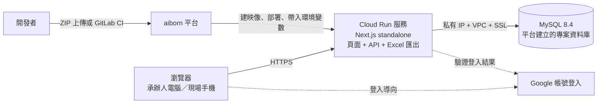

# 技術架構說明（草稿）

| 項目 | 內容 |
|---|---|
| 系統 | Seat Arrangement |
| 文件版本 | v0.3（技術選型、登入與衝突處理已定，細節待正式規格確認後補） |
| 日期 | 2026-11-10 |
| 適用範圍 | 本系統的架構、模組邊界、技術選型、資料、API、部署與演進方式 |
| 讀者 | 參與開發的工程師、Code Reviewer |

> 業務規則以 `docs/spec/` 的正式規格為準；本文件只寫技術做法。決策的理由與過程見 `decision-record.md`，本文以條目編號引用。

## 目錄

1. 摘要
2. 部署平台約束
3. 架構總覽
4. 技術選型
5. 模組化設計
6. 專案目錄結構
7. 資料設計
8. API 設計
9. 認證與授權
10. 前端設計
11. 各模組功能設計
12. 排程工作（Jobs）
13. 檔案儲存
14. 部署
15. 品質：測試、可觀測性、程式碼規範
16. 拆分路線
17. 開發順序
18. 風險與對策
19. 架構決策紀錄（ADR 摘要）
20. 待決事項

---

## 1. 摘要

- **一個 Next.js 全端服務**：頁面、API 與 Excel 匯出都在同一個 Next.js（App Router）專案，打包成一個 Docker 映像，部署為公司 aiborn 平台的「動態網站」。
- **資料庫**：用平台一鍵建立的 MySQL 8.4，以 Prisma 管理資料表與 migration。
- **資料量很小**（約 180 位員工、200 多位參與人員、31 張桌），所以前端開頁時一次載入全部資料，搜尋、篩選、桌次部門標示都在瀏覽器算；每個操作送一個小請求到 API 立即儲存。
- **業務規則寫成純 TypeScript 模組**（`src/domain/`），前端用來即時提示（例如桌次已滿），後端用同一份程式在交易中驗證並寫入。
- **用公司 Google 帳號登入**：只允許公司網域的帳號，登入後所有人權限相同（D-003）。
- **多人同時操作**：每個操作只寫入這一步，後端在交易內檢查規則；違反時前端重新載入最新資料並提示（D-004）。
- **沒有背景工作、沒有檔案儲存**：匯入的 CSV 與匯出的 Excel 都在單次請求的記憶體內處理完。

選型理由見 D-001。

## 2. 部署平台約束

部署目標是 aiborn 的動態網站。以下整理自 aiborn 原始碼與文件（`src/lib/dynamic-site-deploy-prompt.ts`、`src/lib/gcp/deploy-cloud-run.ts`、`src/lib/deploy-gcp-worker.ts`、`docs/PRD.md`、`docs/GCPM_CONFIG.md`，2026-11-09 版）。平台改版時要重新核對。

| 項目 | 平台做法 | 對本專案的影響 |
|---|---|---|
| 部署方式 | 上傳根目錄含 `Dockerfile` 的 ZIP，或用 GitLab CI 帶部署權杖自動上傳；平台以 Cloud Build 建映像，部署到 Cloud Run（gen2） | 專案根目錄放多階段 `Dockerfile`；ZIP 不可含 `node_modules`、`.next`、`dist`、`build` 等目錄（平台會擋）；ZIP 上限個人方案 100 MB、商務方案 300 MB |
| 一個網站一個服務 | 每個動態網站是一個 Cloud Run 服務；個人方案只能有 1 個動態網站，商務方案 3 個 | 前後端不拆成兩個服務（第 16 節） |
| 埠號 | 固定 8080，服務要監聽 `0.0.0.0` 並讀環境變數 `PORT` | Next.js standalone 的 `server.js` 讀 `PORT`；Dockerfile 設 `HOSTNAME=0.0.0.0`、`EXPOSE 8080` |
| 對外網址 | 正式環境回傳 Cloud Run 公開網址（`https://<服務>-<專案編號>.asia-east1.run.app`），**任何拿到網址的人都能開啟**；平台的成員名單只管靜態網站，不擋動態網站 | 平台不提供存取控制，由本專案自己做 Google 登入（第 9 節、D-003）；網址第一次部署後才確定，Google 登入的回呼網址要等它 |
| Google 登入 | 平台可代申請 Google OAuth 用戶端：在專案填 JavaScript 來源與重新導向 URI 送出，由平台管理者手動建立後回填 Client ID 與 Secret（待處理 → 處理中 → 已完成），再按「帶入環境變數」寫入 `GOOGLE_CLIENT_ID`、`GOOGLE_CLIENT_SECRET`。平台規格建議回呼路徑用 `/api/auth/callback/google`、允許的網域讀 `ALLOWED_EMAIL_DOMAIN` | 申請靠人工處理，要提早送（階段 1 第一次部署後）；同一個用戶端可列多個重新導向 URI，正式網址與本機 `http://localhost:3000` 一起申請 |
| 反向代理 | 網站在 HTTPS 反向代理後面；平台要求信任代理、產生的網址與導向一律用 https | 程式不自己組絕對網址；導向用相對路徑 |
| 資料庫 | 平台一鍵建立 MySQL 8.4 的 database 與 user；app 走私有 IP + VPC 的 TCP 連線，**必須開 SSL、不驗憑證**；連線資訊以 `DATABASE_HOST`、`DATABASE_PORT`、`DATABASE_NAME`、`DATABASE_USER`、`DATABASE_PASSWORD` 提供 | 啟動時由這五個變數組出 Prisma 連線字串（密碼做 URL 編碼）；不用 SQLite、不把資料存檔案 |
| 資料庫限制 | 個人方案：同時連線 10、每小時查詢 5 萬次、每小時寫入 1 萬次、容量 1 GB、最多 50 張表；超過 15 秒的查詢、60 秒的交易會被終止。商務方案約為 5–10 倍 | 本專案的量遠低於上限（第 7.4 節）；Prisma 連線池設小（預設 3），避免多個執行個體用光 10 條連線 |
| Migration | 平台規格要求服務啟動前先執行 `prisma migrate deploy`，失敗就結束 | 寫在 `docker-entrypoint.sh`（第 14 節） |
| 環境變數 | 平台的「環境變數」編輯器（KEY／VALUE），部署時帶入 Cloud Run | 所有設定與密碼都讀環境變數；提供 `.env.example` |
| 容器檔案系統 | 重新部署或重啟後檔案消失；可另外掛「磁碟區」（雲端儲存掛載） | 不寫本機檔案，也不需要磁碟區（第 13 節） |
| 運算資源 | 平台部署時沒有指定 CPU、記憶體與最少執行個體，沿用 Cloud Run 預設（1 vCPU、512 MiB、最少 0 個執行個體、單一執行個體同時處理 80 個請求） | 一段時間沒人用就會冷啟動，第一個請求要多等幾秒（第 18 節）；512 MiB 足夠產生 Excel |
| 健康檢查 | 平台規格要求 `GET /api/health` 回 200 | 實作此端點（第 8 節） |
| 時區 | Cloud Run 預設 UTC | Dockerfile 設 `TZ=Asia/Taipei`，匯出檔名的日期才是台灣日期 |
| 對外連線 | 預設只有私有網段走 VPC，連外走 Cloud Run 共用出口 | 執行期不連任何外部服務；字型、圖示、Excel 套件都打包進映像 |
| Log | 平台「網站監控」頁可讀服務 Log（stdout／stderr） | 依 `docs/standard/LOG_Design_Guideline.md` 輸出單行 JSON（第 15.2 節） |

## 3. 架構總覽



一個請求的路徑：

1. `src/proxy.ts`（Next.js 16 的 proxy，舊名 middleware）先檢查登入：沒登入時，頁面導向登入頁、API 回 401（第 9 節）。
2. 開啟網址時，伺服器端元件直接讀資料庫，把全部資料（員工、參與人員、桌次）連同頁面一起送到瀏覽器。
3. 使用者每做一個操作（拖移、新增、編輯、刪除），前端先更新畫面，再把這個操作送到對應的 API。
4. API 用 zod 檢查輸入，在一個資料庫交易內套用 `src/domain/` 的規則並寫入，回傳變更後的資料。
5. 前端用回傳的資料校正畫面，Header 顯示「已儲存 {時:分}」。失敗時保留畫面上的結果，顯示「重試」。

別人的改動不會自動出現在畫面上，重新整理才看到（需求已確認不做即時同步）；操作違反規則時才會自動重新載入（D-004）。

## 4. 技術選型

版本原則：建立專案時取各套件的最新穩定版，寫進 `package.json` 與 `package-lock.json` 鎖定，之後升級要跑全部測試。

| 類別 | 選擇 | 理由 |
|---|---|---|
| 執行環境 | Node.js 24 LTS | 與 aiborn 平台自身映像同一個大版本；`.nvmrc` 與 `package.json` 的 `engines` 一致 |
| 框架 | Next.js（App Router）+ React + TypeScript，`output: "standalone"` | 使用者熟悉；平台規格直接支援 Next.js standalone；頁面與 API 同一個服務 |
| API | Next.js Route Handlers（`src/app/api/**/route.ts`），輸入用 zod 驗證 | 有明確的 HTTP 契約與錯誤碼，方便做依序送出、重試的儲存佇列，也方便整合測試（D-001） |
| 登入 | Auth.js（next-auth）+ Google provider，JWT session | 不需要 session 資料表；aiborn 平台自身也用 NextAuth；預設回呼路徑就是平台建議的 `/api/auth/callback/google`（D-003） |
| 資料庫 | MySQL 8.4（平台提供） | 平台唯一提供的資料庫 |
| ORM | Prisma | 平台規格的預設做法（`prisma migrate deploy`）；schema 與 migration 版本化 |
| 前端狀態 | Zustand（全部資料放在一個 store）+ 自寫的儲存佇列 | 資料量小，不需要分頁或快取層；佇列負責依序送出與儲存狀態 |
| 樣式 | Tailwind CSS + 設計系統的 CSS 變數（`tokens.css`） | 設計系統以語意 token 與 Tailwind 為前提 |
| 元件 | shadcn/ui（Radix）：Dialog、Alert Dialog、Dropdown Menu、Popover、Tooltip、Table、Badge、Skeleton、Sonner | 設計系統的元件規格就是這組元件；原始碼放在專案內可依規格調整 |
| 圖示 | Lucide | 設計系統指定 Lucide 或 Phosphor |
| 拖移 | dnd-kit（core + sortable） | 同時支援滑鼠、觸控與鍵盤；支援跨容器拖移（人員面板 ↔ 桌次 ↔ 工作人員桌）與容器內排序 |
| 座位圖縮放與平移 | 自寫 CSS transform（縮放、適合視窗、平移），沿用原型做法 | 只需要按鈕縮放與拖曳平移，不值得多一個套件；要讓 dnd-kit 依縮放比例換算座標（第 18 節） |
| Excel 匯出 | ExcelJS，在伺服器產生 | 原型已用 ExcelJS 4.4 驗證過版面（合併儲存格、底色、框線、橫向一頁）；改在伺服器產生，資料以資料庫為準，也能寫測試 |
| CSV 匯入 | papaparse 解析；iconv-lite 處理編碼 | Excel 另存的 CSV 可能是 UTF-8（含 BOM）或 Big5，先試 UTF-8，不合法再用 Big5 |
| 單元與整合測試 | Vitest | 與 TypeScript 原生整合；整合測試連本機 MySQL 測試庫 |
| E2E 與截圖 | Playwright | 跑完整流程，並在 320 px 與桌面寬度截圖 |
| Log | 自寫的小型 JSON logger（`src/server/log.ts`） | 規範要求的欄位很固定，不需要額外套件 |

不採用：

- **帳號與角色管理**：登入只用來確認是公司同仁，不建使用者資料表、不分角色（D-003）。
- **WebSocket、即時同步**：需求已確認不做；Cloud Run 也不適合長連線。
- **Server Actions 作為主要 API**：見 D-001。
- **獨立後端服務（Express、FastAPI）**：見第 16 節。

## 5. 模組化設計

依「業務規則 → 伺服器 → 介面」分三層，依賴只能往內：`app/`、`components/`、`client/` 可以用 `server/` 或 `domain/`；`server/` 可以用 `domain/`；`domain/` 不引用 Next.js、React 或 Prisma。

| 層 | 目錄 | 職責 | 測試方式 |
|---|---|---|---|
| 業務規則 | `src/domain/` | 型別、顯示名稱、桌次部門標示、入座與工作人員桌的檢查、自動排座、匯入列的轉換與驗證、匯出版面模型、30 桌的排列。輸入資料、回傳結果，不碰資料庫 | Vitest 單元測試，涵蓋每條規則 |
| 伺服器 | `src/server/` | Prisma 存取、在交易中套用 domain 規則、CSV 編碼與解析、ExcelJS 輸出、錯誤格式、Log | Vitest 整合測試，連測試資料庫 |
| API 契約 | `src/contracts/` | 每個 API 的 zod 輸入格式與回應型別；Route Handler 用來驗證輸入，前端呼叫時共用型別。平行開發時各線照契約各做前後端 | 隨 API 整合測試 |
| API | `src/app/api/` | Route Handler：解析輸入 → 呼叫 `server/services` → 回 JSON。不寫業務邏輯 | 整合測試直接呼叫 handler |
| 前端狀態 | `src/client/` | 全部資料的 store、樂觀更新、儲存佇列、復原 | Vitest 單元測試（佇列與 store） |
| 介面 | `src/app/(main)/`、`src/components/` | 頁面、App Shell、座位圖、人員面板、對話框 | Playwright |

功能模組在各層用相同名稱對應：

| 功能模組 | domain | server/services | API |
|---|---|---|---|
| 員工名單 | `employees.ts`、`roster-import.ts` | `employees.ts` | `/api/employees` |
| 參與人員 | `participants.ts`、`registration-import.ts` | `participants.ts` | `/api/participants` |
| 座位安排 | `seating-rules.ts`、`auto-arrange.ts`、`layout.ts` | `seating.ts` | `/api/seating`、`/api/tables` |
| 匯出座位表 | `seating-sheet.ts` | `export.ts` | `/api/export/seating` |
| 登入 | `auth-policy.ts`（公司網域檢查） | `server/auth.ts`（Auth.js 設定） | `/api/auth/*`、`src/proxy.ts` |

## 6. 專案目錄結構

應用程式放在 repo 根目錄，和 `docs/`、`ui-design-system/` 並列。

```text
seat-arrangement/
├── AGENTS.md、CLAUDE.md
├── docs/                         # 專案文件（不進映像）
├── ui-design-system/             # 設計系統，只給開發與 AI 讀（不進映像）
├── prisma/
│   ├── schema.prisma
│   ├── migrations/
│   └── seed-data/                # roster.csv、registrations.csv，可選的 staff.csv、tables.csv；不進 repo，只在第一次手動部署的 ZIP 帶上（D-007）。匯入程式在 src/server/seed.ts
├── src/
│   ├── proxy.ts                  # 登入檢查（第 9 節；Next.js 16 的 proxy，舊名 middleware）
│   ├── app/
│   │   ├── login/page.tsx        # 登入頁，不套 App Shell
│   │   ├── (main)/
│   │   │   ├── layout.tsx        # App Shell：左側導覽、Header、儲存狀態；伺服器端讀全部資料
│   │   │   ├── page.tsx          # 座位安排（/）
│   │   │   ├── people/page.tsx   # 參與人員
│   │   │   └── employees/page.tsx# 員工名單
│   │   ├── api/                  # Route Handlers（第 8 節），含 auth/[...nextauth]
│   │   └── not-found.tsx
│   ├── contracts/                # 所有 API 的 zod 輸入格式與回應型別，前後端共用
│   ├── domain/                   # 純 TypeScript 業務規則
│   ├── server/
│   │   ├── db.ts                 # Prisma client 與連線設定
│   │   ├── auth.ts               # Auth.js 設定
│   │   ├── services/
│   │   ├── http.ts               # 輸入驗證、錯誤格式、請求 Log
│   │   ├── csv.ts
│   │   ├── excel.ts
│   │   └── log.ts
│   ├── client/
│   │   ├── store.ts
│   │   ├── save-queue.ts
│   │   └── api.ts
│   ├── components/
│   │   ├── ui/                   # shadcn/ui 元件，依設計系統調整
│   │   └── features/             # seating-map、people-panel、table-detail、各對話框
│   └── styles/
│       ├── tokens.css            # 從 ui-design-system/token-gallery/data/tokens.css 複製
│       └── globals.css
├── public/                       # Logo 等靜態檔
├── tests/
│   ├── unit/
│   ├── integration/
│   ├── e2e/
│   └── fixtures/                 # 虛構的測試資料
├── Dockerfile
├── docker-entrypoint.sh
├── docker-compose.yml            # 本機 MySQL 8.4（開發庫與測試庫）
├── .dockerignore                 # 排除 docs/、ui-design-system/、tests/、.env*、.git
├── .env.example
└── .nvmrc
```

- `tokens.css` 是複製品：設計系統更新 token 時同步複製一次，不在執行期讀 `ui-design-system/`。
- 原型的 `ui-design-system/source-reference/html/` 是頁面版型的依據，不搬進 `src/`。
- 程式與測試都只用虛構資料。真實的員工名單與尾牙報名表不進 repo：上線時放在 `prisma/seed-data/`，隨第一次手動部署的 ZIP 進映像，由 seed 匯入正式資料庫一次（D-007）；之後的異動用畫面上的功能。原型的真實資料檔與 `docs/glossary/` 也都在 `.gitignore`（D-002）；組別的來源是 `docs/glossary/組別名單.csv`。

## 7. 資料設計

### 7.1 資料表

三張表。部門、組別、顯示名稱、桌次部門標示、工作人員身分都由資料推導，不另外存。

```prisma
model Employee {
  id          Int          @id @default(autoincrement())
  name        String       @db.VarChar(50)
  englishName String?      @db.VarChar(100)
  department  String       @db.VarChar(50)
  team        String?      @db.VarChar(50)   // 組別，選填
  extension   String?      @db.VarChar(50)   // 多個分機合併為「1234／1235」；N/A 存 null
  region      String?      @db.VarChar(20)
  office      String?      @db.VarChar(50)
  note        String?      @db.VarChar(500)
  declined    Boolean      @default(false)   // 承辦人標記為不參加（D-014）；有參與人員時一律視為已報名，加入尾牙時清掉
  sortOrder   Int                            // 員工名單順序，決定部門與組別的排序
  participant Participant? @relation("EmployeeParticipant")
  createdAt   DateTime     @default(now())
  updatedAt   DateTime     @updatedAt

  @@index([name, department])                // 匯入時以姓名加部門對應
  @@index([sortOrder])
}

enum ParticipantKind {
  EMPLOYEE
  DEPENDENT
  GUEST
}

model Participant {
  id           Int             @id @default(autoincrement())
  kind         ParticipantKind
  employeeId   Int?            @unique        // EMPLOYEE：一位員工最多報名一次
  employee     Employee?       @relation("EmployeeParticipant", fields: [employeeId], references: [id], onDelete: Cascade)
  hostId       Int?            @unique        // DEPENDENT：所屬員工的參與人員；unique 確保最多一位眷屬
  host         Participant?    @relation("Dependent", fields: [hostId], references: [id], onDelete: Cascade)
  dependent    Participant?    @relation("Dependent")
  relation     String?         @db.VarChar(20)  // 眷屬稱謂
  guestName    String?         @db.VarChar(50)  // GUEST
  organization String?         @db.VarChar(100) // GUEST 單位
  title        String?         @db.VarChar(50)  // GUEST 頭銜
  childSeat    Boolean         @default(false)
  vegetarian   Boolean         @default(false)
  note         String?         @db.VarChar(500)
  tableId      Int?                             // null = 未入座
  table        SeatTable?      @relation(fields: [tableId], references: [id])
  seatOrder    Int?                             // 桌內名單順序，0 起算
  createdAt    DateTime        @default(now())
  updatedAt    DateTime        @updatedAt

  @@index([tableId, seatOrder])
}

enum TableKind {
  NORMAL
  STAFF
}

model SeatTable {
  id           Int           @id                // 1–30 是內部編號；畫面上的桌號（A1～A15、B1～B15）由 src/domain/layout.ts 的位置代碼對應（D-019）；工作人員桌固定為 0
  kind         TableKind
  noteName     String?       @db.VarChar(50)   // 備註名稱
  participants Participant[]
}
```

設計說明：

- **連動刪除交給外鍵**：刪除員工 → 參與人員 → 眷屬依序 cascade；取消報名刪除參與人員時眷屬一併刪除。座位存在參與人員列上，人刪了座位就空出來，不需要另外處理。
- **工作人員 = 坐在工作人員桌的員工**：不另存旗標，避免兩個欄位不一致。人員對話框勾「工作人員」時，後端把他移進工作人員桌；取消勾選則移出成未入座。
- **桌次固定**：1–30 桌與工作人員桌寫在第一個 migration 的 INSERT。30 桌在座位圖上的位置寫在 `src/domain/layout.ts`，不存資料庫。
- **沒有使用者資料表**：登入狀態是存在 cookie 的 JWT session，不建帳號或 session 資料表（D-003）。
- **只存需要的欄位**：通訊錄的手機號碼與代接群組沒有用到，匯入時略過不存。
- **不對 `(tableId, seatOrder)` 加 unique**：調整順序時會短暫重複，改由服務層在交易內重排並保證連續。

### 7.2 一致性規則（服務層在交易內檢查）

| 規則 | 檢查方式 |
|---|---|
| 一般桌與工作人員桌標準 10 位、最多 12 位（D-018）：拖移與「加入人員」的指令帶 `allowOverflow` 時上限 12，其他入口（選擇桌次、人員對話框的桌次與工作人員）上限 10；工作人員桌只放員工 | 交易開始先 `SELECT ... FOR UPDATE` 鎖住涉及的桌次列（依內部編號由小到大鎖，避免死結），再計算人數 |
| 眷屬的所屬員工必須已報名 | `hostId` 指向 `kind = EMPLOYEE` 的參與人員 |
| 各類別的必填欄位 | zod schema 依 `kind` 區分 |
| 桌內順序連續 | 每次異動後把該桌 `seatOrder` 重排為 0..n-1 |

寫入的交易一律用 `READ COMMITTED` 隔離等級（Prisma `isolationLevel: ReadCommitted`）。MySQL 預設的 `REPEATABLE READ` 會讓交易停在第一次讀取的快照：先讀一次、再鎖住桌次，之後的一般讀取仍看不到別人在這之間提交的異動，鎖住後的檢查就失效。

### 7.3 Migration 與初始資料

- 開發時用 `prisma migrate dev` 產生 migration，提交進 repo。
- 正式環境啟動時執行 `prisma migrate deploy` 與 `seed`（第 14 節）。
- 1–30 桌與工作人員桌寫在第一個 migration 的 INSERT，不靠 seed。
- seed 在 `prisma migrate deploy` 之後、伺服器接受請求之前執行：Next.js 啟動時由 `src/instrumentation.ts` 呼叫 `src/server/seed.ts`，失敗就結束程序。正式映像沒有 TypeScript 執行工具，借用 Next.js 已打包好的程式與 Prisma Client，不另外建置。只在 `SEED_IMPORT=1`（Dockerfile 設定）時執行，本機開發與測試不會匯入真實資料。員工表是空的、而且 `prisma/seed-data/roster.csv` 與 `registrations.csv` 都存在時，匯入員工名單，再匯入報名表成為參與人員（D-007）。接著有 `staff.csv`（姓名、部門）時，把這些人設為工作人員、依檔案順序放進工作人員桌；有 `tables.csv`（桌號、備註名稱）時寫入備註名稱（D-015）；桌號欄寫桌號（A1～A15、B1～B15，D-019）。對不到、沒有報名、超過工作人員桌人數或格式不符的列略過並記 Log。seed 不自動排座。
  - 這幾步在同一個 `READ COMMITTED` 交易內完成，交易一開始 `SELECT … FOR UPDATE` 鎖住工作人員桌那一列（第一個 migration 就有，一定存在），鎖到 commit 或 rollback 才放開；多個執行個體同時啟動時，後面的會等前面的 commit 後才檢查員工表，看到已有資料就跳過。任何一列以外的錯誤就整批不寫入。
  - Log 只記筆數（匯入、對不到、略過），不記姓名（第 15.2 節）；對不到與略過的人名在部署前用本機試跑確認（D-007）。
  - 員工表已有資料、或資料檔不存在時跳過，並記一筆 Log；所以重新部署與冷啟動都不會蓋掉上線後的修改。
  - 匯入摘要（員工、參與人員、眷屬的筆數，以及對不到員工名單的報名者）寫進 Log，不印電子郵件。
- 資料表變更只能新增 migration，不改已部署過的 migration。

### 7.4 資料量估算

| 項目 | 估算 | 平台上限（個人方案） |
|---|---|---|
| 資料筆數 | 員工約 200、參與人員約 250、桌次 31 | — |
| 全部資料的 JSON | 約 100 KB | — |
| 資料表 | 3 張（加上 Prisma 的 migration 紀錄表） | 50 張 |
| 容量 | 遠小於 10 MB | 1 GB |
| 寫入 | 一次拖移約 1–12 筆更新；自動排座約 200 筆，在一個交易內完成 | 每小時 1 萬次 |

## 8. API 設計

全部是 JSON，路徑前綴 `/api`。除了 `/api/health` 與 `/api/auth/*`，都要登入（第 9 節）。每個寫入 API 在一個資料庫交易內完成，回傳變更後的資料讓前端校正。

| 方法與路徑 | 用途 |
|---|---|
| `GET /api/health` | 健康檢查，回 200；不需登入，不連資料庫（避免冷啟動時被判定失敗） |
| `/api/auth/*` | Auth.js 的登入、回呼、登出，路徑由套件提供 |
| `GET /api/state` | 全部員工、參與人員與桌次；重新整理或發生衝突後重新載入用 |
| `POST /api/employees` | 新增員工 |
| `PATCH /api/employees/{id}` | 編輯員工 |
| `DELETE /api/employees/{id}` | 刪除員工；已報名者一併取消報名、移除眷屬、空出座位 |
| `PUT /api/employees/{id}/declined` | 標記為不參加或改回未報名（`{ declined: boolean }`）；這位員工已報名時回 409（D-014） |
| `POST /api/employees/import` | 上傳通訊錄 CSV（multipart），建立或更新員工；回傳成功筆數與需要處理的列 |
| `POST /api/participants` | 新增參與人員：員工加入尾牙（可同時加一位眷屬）、眷屬、外部貴賓 |
| `POST /api/participants/bulk-join` | 勾選多位員工一次加入尾牙 |
| `PATCH /api/participants/{id}` | 編輯參與人員（含兒童椅、素食、工作人員） |
| `DELETE /api/participants/{id}` | 取消報名（員工，眷屬一併移除）或刪除（眷屬、外部貴賓） |
| `POST /api/participants/import` | 上傳參與人員 CSV |
| `POST /api/seating/operations` | 座位異動指令（見下方） |
| `PATCH /api/tables/{id}` | 修改桌次備註名稱 |
| `GET /api/export/seating` | 下載座位表 Excel（`座位表_{YYYYMMDD}.xlsx`） |

### 8.1 座位異動指令

所有會影響座位、而且可以復原的操作走同一個端點，請求本體是一個帶 `type` 的指令：

```ts
type SeatingOperation =
  | { type: "seat"; participantId: number; tableId: number; index?: number; allowOverflow?: boolean } // 入座、加入、搬移、拖進工作人員桌
  | { type: "unseat"; participantId: number }                               // 移出桌次或工作人員桌
  | { type: "reorder"; tableId: number; participantIds: number[] }          // 桌內調整順序
  | { type: "clear"; tableId: number }                                       // 清空
  | { type: "swap"; tableA: number; tableB: number }                         // 整桌對調（名單與備註名稱）
  | { type: "autoArrange"; mode: "unseatedOnly" | "rebuild" }               // 自動排座
  | { type: "restore"; snapshot: SeatingSnapshot };                          // 復原
```

回應：

```ts
type SeatingOperationResult = {
  participants: { id: number; tableId: number | null; seatOrder: number | null }[]; // 有變動的人
  tables: { id: number; noteName: string | null }[];                               // 有變動的桌（對調時）
  undo: SeatingSnapshot;   // 這次操作之前的狀態，送回 restore 就能復原
  summary?: { placed: number; tableIds: number[]; left: number };                  // 自動排座的結果
};
```

- 每個指令都回傳 `undo`，前端只保留最近一次；按「復原」就送 `{ type: "restore", snapshot }`。復原記錄只存在瀏覽器記憶體，重新整理後就沒有了。
- `seat`、`seatMany` 帶 `allowOverflow: true`（拖移與「加入人員」）時每桌上限 12 位，不帶時上限 10 位（選擇桌次對話框）；`restore`、`swap` 上限 12 位；`autoArrange` 每桌只排到 10 位（D-018）。超過上限時回 409，錯誤碼區分 10 位（`TABLE_FULL`）與 12 位（`TABLE_LIMIT`），前端照 `seating.md` SEAT-R86 顯示不同提示。
- 新增、編輯、刪除、加入尾牙、取消報名、匯入不走這個端點，也不能復原。

### 8.2 錯誤格式

```json
{ "error": { "code": "TABLE_FULL", "message": "..." } }
```

| HTTP | code | 何時 | 前端處理 |
|---|---|---|---|
| 400 | `VALIDATION_FAILED` | 輸入格式不對 | 顯示欄位錯誤（正常操作不會發生） |
| 400 | `IMPORT_FORMAT_INVALID` | CSV 欄位和範本不一致 | 顯示匯入對話框的格式錯誤文案 |
| 401 | `UNAUTHENTICATED` | 沒有登入或登入已過期 | 導向登入頁 |
| 404 | `NOT_FOUND` | 資料已被別人刪除 | 重新載入全部資料，顯示「資料已被其他人更新，已重新載入。」（D-004） |
| 409 | `TABLE_FULL`、`STAFF_TABLE_FULL`、`STAFF_EMPLOYEE_ONLY` | 寫入時才發現違反規則（通常是別人剛改過） | 重新載入全部資料，顯示規格中既有的文案，例如桌次已滿（D-004） |
| 409 | `DUPLICATE_PARTICIPANT`、`DEPENDENT_EXISTS` | 員工已被別人加入、已有眷屬 | 重新載入全部資料，顯示「資料已被其他人更新，已重新載入。」（D-004） |
| 500 | `INTERNAL` | 其他錯誤 | Header 顯示儲存失敗與「重試」 |

畫面文案由前端依 `code` 對應正式規格，API 的 `message` 只給開發者看。

## 9. 認證與授權

依 D-003：用公司 Google 帳號登入，只允許公司網域的帳號。登入只用來確認是公司同仁，登入後所有人權限相同，不分角色，也沒有唯讀模式。原因是平台的正式網址公開（第 2 節），而資料包含全公司員工的姓名、分機與座位。

### 9.1 登入流程

1. 沒登入的人開任何頁面，`src/proxy.ts` 導向 `/login`，並記住原本要開的頁面。
2. 登入頁按下登入後，Auth.js 導向 Google；Google 登入完成後回到 `/api/auth/callback/google`。
3. 伺服器在 Auth.js 的 `signIn` callback 檢查：Google 回傳的 `email_verified` 為 true，email 網域等於 `ALLOWED_EMAIL_DOMAIN`，`hd` 欄位也是這個網域。不符合就拒絕，回到登入頁顯示錯誤。導向 Google 時帶的 `hd` 參數只是讓 Google 預選公司帳號，不能當作檢查。
4. 通過後發 JWT session cookie（`HttpOnly`、`Secure`、`SameSite=Lax`），有效 30 天，使用中自動延長；導回原本要開的頁面。
5. 登出由 Auth.js 清除 cookie 後回到登入頁。

登入頁、被拒與失敗的錯誤畫面依原型 `login.html`；登出放在 Sidebar 底部的使用者選單。文案以正式規格為準。

### 9.2 保護範圍

| 路徑 | 未登入時 |
|---|---|
| 所有頁面 | 導向 `/login`，登入後回到原頁 |
| `/api/**`（下面兩項除外） | 回 401 `UNAUTHENTICATED` |
| `/api/health` | 不需登入（平台健康檢查用） |
| `/api/auth/*`、`/login` | 不需登入 |

- 檢查集中在 `src/proxy.ts`。每個 Route Handler 透過 `src/server/http.ts` 的 `route()` 再用 `getServerSession` 確認一次，避免 proxy 的路徑比對寫漏時 API 沒有保護。
- 寫入 API 另外檢查 `Origin` 標頭與網站相同，搭配 `SameSite=Lax` 防跨站請求。
- 不建使用者或 session 資料表，不保存誰登入過；Log 只記 Google 帳號的 ID（第 15.2 節）。

### 9.3 其他安全措施

- API 一律驗證輸入。
- 回應加上基本的安全標頭（`X-Content-Type-Options`、`Referrer-Policy`、`frame-ancestors 'none'`）。
- Log 不記錄姓名、分機與 email（第 15.2 節）。

## 10. 前端設計

### 10.1 頁面與路由

| 路徑 | 頁面 | 依據的原型 |
|---|---|---|
| `/` | 座位安排（人員面板 + 座位圖，桌次詳情為浮出面板，手機為 Dialog） | `ui-design-system/source-reference/html/seating.html` |
| `/people` | 參與人員 | `people.html` |
| `/employees` | 員工名單 | `employees.html` |
| `/login` | 登入頁，不套 App Shell | `login.html` |

三頁共用 `(main)/layout.tsx` 的 App Shell。切換頁面時 layout 不重新渲染，store 裡的資料與儲存佇列都保留。

### 10.2 資料載入

- `(main)/layout.tsx` 是伺服器端元件，直接呼叫 `server/services` 讀全部資料（不經 HTTP），交給前端的 store provider；頁面設為動態渲染，不快取。
- 之後的搜尋、篩選、分頁、找人、桌次部門標示、入座統計都在瀏覽器以 store 計算，呼叫 `src/domain/` 的同一份函式。
- 載入中以 Skeleton 呈現。

### 10.3 立即儲存與儲存狀態

`src/client/save-queue.ts` 負責：

1. 操作發生時先用 domain 規則檢查（例如桌次已滿就直接提示，不送出），通過後更新 store，並把請求排進佇列。
2. 佇列**一次只送一個請求**，依操作順序送出，避免先後顛倒。
3. Header 的儲存狀態由佇列推導：佇列有請求時為「儲存中…」；清空後為「已儲存 {時:分}」；請求失敗時為儲存失敗與「重試」。
4. 網路錯誤或 500：佇列暫停，畫面保留使用者看到的結果；按「重試」從失敗的請求接著送。
5. 409 或 404（資料已被別人改過）：不重試，佇列中還沒送出的操作一併捨棄（它們是根據舊資料做的），重新載入 `GET /api/state`。違反桌次人數等規則時用規格中既有的文案（例如桌次已滿），其他情況以 Sonner 顯示「資料已被其他人更新，已重新載入。」（D-004）。
6. 401（登入過期）：佇列暫停，導向登入頁；登入後重新載入資料，未送出的操作不保留。session 使用中會自動延長，正常使用很少遇到。
7. 每個請求成功後，用回應的資料覆蓋 store 中對應的列，確保畫面與資料庫一致。

### 10.4 拖移與座位圖

- dnd-kit 的可放置區：人員面板、每一桌、工作人員桌；可排序區：每一桌的名單。拖桌次的把手到另一桌觸發整桌對調。
- 感應器同時啟用滑鼠、觸控（長按啟動，避免和捲動衝突）與鍵盤。
- 座位圖以 CSS `transform: scale()` 縮放，拖移時用 dnd-kit 的 modifier 依縮放比例換算座標。
- 這是技術風險最高的部分，座位安排線一開始先做最小驗證（第 17 節）。

### 10.5 設計系統

- 依 `AGENTS.md` 的 UI Design System 一節：頁面區塊照原型 HTML，元件照 `03-components.md`，顏色、字級、間距一律用語意 token。
- `tokens.css` 的 CSS 變數接到 Tailwind 主題，元件只用 token，不寫死色碼，不用非中性的 Tailwind 色盤。
- Dropdown Menu、Popover 用 Radix 的 portal，不靠調高 `z-index` 解決裁切。
- 320 px 到桌面都不能出現整頁水平捲動；座位圖在自己的容器內平移。

## 11. 各模組功能設計

### 11.1 員工名單

- **匯入**（`roster-import.ts`）：解析通訊錄 CSV → 依欄名判斷和範本是否一致（D-012）→ 略過總機資訊、公共區域、英文名空白的設備列與「空位」列（D-012）→ 同一人多個分機合併 → 分機 N/A 視為沒有分機 → 以「姓名 + 部門」對應既有員工，有就更新、沒有就新增 → 有錯誤的列不匯入，其餘照常匯入。
- 匯入順序寫進 `sortOrder`；新增的員工排在最後。
- 匯入結果回傳需要處理的列（列號、原始內容、原因），「下載錯誤清單」由前端把它轉成 CSV 下載，伺服器不存檔。
- 上傳大小上限 1 MB（通訊錄約 30 KB）。

### 11.2 參與人員

- 顯示名稱、部門、分機由 `domain/participants.ts` 推導：員工取員工名單；眷屬為「{員工姓名}_眷屬」、部門跟著所屬員工；外部貴賓顯示姓名與單位／頭銜。
- 加入尾牙、取消報名、刪除的連動依第 7.1 節的外鍵規則。
- **報名表**（`registration-import.ts`，seed 與參與人員頁的匯入共用，D-007、D-010）：解析 Google 表單匯出的報名表，規則以 `docs/spec/participants.md` 第 3.6 節為準。欄位以表頭文字辨認：名字、部門、是否參加、是否攜帶眷屬、是否需要兒童座椅、本人與眷屬的飲食習慣、本人葷素（可缺）、備註。只收「是」參加的人；同一人填好幾次時以最後一次為準；以姓名對應員工名單，同名再用部門判斷；攜帶眷屬時加一位眷屬，兒童座椅填「是」時眷屬需要兒童椅，回答含「素」而且不含「葷」才標素食；備註照填。對不到員工名單的人不匯入，列進匯入摘要。電子郵件與填寫時間不存。單元測試用虛構的表單 CSV，涵蓋重複填寫、不參加、對不到員工名單、同名與表頭含全形空白或特殊字元（實際表頭的「尾牙」用了異體字 `⽛`）。

### 11.3 座位安排

- 桌號（D-019）：資料庫與 API 的桌次仍用內部編號 1–30（工作人員桌 0），畫面、匯出與網址參數（`/?table=A1`）都用位置代碼 A1～A15、B1～B15，對應寫在 `src/domain/layout.ts`。清單依 A1～A15、B1～B15 排列；自動排座的填桌順序沿用內部編號的順序（`docs/spec/auto-arrange.md` 的「填桌順序」）。
- `seating-rules.ts` 對每個指令回傳「變更後的座位」或「違反哪條規則」，前端與後端共用。
- 員工拖進工作人員桌時離開原本的桌次；眷屬不跟著移動。
- 桌次的部門標示（依人數排序、以「＋」連接、有貴賓時加「貴賓」、沒人時為「空桌」）由前端即時計算，不存資料庫。
- **自動排座**（`auto-arrange.ts`）：純函式，輸入員工名單順序、參與人員與目前座位、範圍（只排未入座／清空後重排），輸出新的座位與摘要。後端在一個交易內執行並寫入；回傳的 `undo` 可以一次復原整個自動排座。演算法依正式規格的排座規則實作，並以示範資料的預期結果寫成單元測試。

### 11.4 匯出座位表

- `seating-sheet.ts` 把資料轉成與 Excel 無關的版面模型：每一格的位置、文字、合併範圍、底色類別（貴賓、兒童椅、素食、標題）、框線。
- `server/excel.ts` 用 ExcelJS 依模型產生 `.xlsx`：橫向列印、寬度縮成一頁。
- 底色來自設計系統 token 調淡後的色碼。Excel 只吃固定色碼，所以在 `server/excel.ts` 定義一組常數，註明對應的 token；token 改了要同步更新。
- 版面模型可以單獨測試（某一桌在第幾欄第幾列、標題格內容），不必解析 Excel 檔。

## 12. 排程工作（Jobs）

沒有排程或背景工作。匯入、自動排座、匯出都在單次請求內完成：最多約 250 筆資料，遠低於 Cloud Run 預設 300 秒的請求逾時與平台 60 秒的長交易限制。

## 13. 檔案儲存

不需要檔案儲存，也不在平台建立磁碟區：

- 匯入：CSV 讀進記憶體解析，不保存原檔。
- 錯誤清單：由前端從 API 回應產生下載。
- 匯出：每次即時產生 Excel，直接回傳給瀏覽器。

## 14. 部署

### 14.1 映像

多階段 Dockerfile（參考 aiborn 平台自身的寫法）：

1. **deps**：`npm ci --ignore-scripts`，再明確執行 `prisma generate`（不執行套件的 install script，降低供應鏈風險）。
2. **builder**：`next build`，產出 `.next/standalone`。
3. **migrator**：在獨立的 `/opt/migrate` 安裝與專案同版本的 Prisma CLI，放 `prisma.config.ts`、`src/server/database-config.ts`、schema 與 migrations，供啟動時 migrate。
4. **runner**：`node:24-bookworm-slim`；複製 standalone、`.next/static`、`public/`、`/opt/migrate`、`prisma/seed-data/`（沒有時是空資料夾）；以非 root 使用者執行；`ENV PORT=8080 HOSTNAME=0.0.0.0 TZ=Asia/Taipei NODE_ENV=production SEED_IMPORT=1`；`EXPOSE 8080`。

`docker-entrypoint.sh`：

1. 在 `/opt/migrate` 執行 `prisma migrate deploy`（設逾時，失敗就結束）。連線字串由 `prisma.config.ts` 用 `DATABASE_*` 組出（密碼 URL 編碼、`sslaccept=accept_invalid_certs`）。
2. `exec node server.js`。伺服器啟動時 `src/instrumentation.ts` 先執行 seed（第 7.3 節、D-007）：員工表是空的、而且有 `prisma/seed-data/` 的兩個資料檔時匯入真實名單，否則跳過並記 Log；seed 失敗就結束程序，不接受請求。

執行期的連線用 MariaDB driver adapter，SSL 設為 `{ rejectUnauthorized: false }`，連線池上限 `DATABASE_CONNECTION_LIMIT`（`src/server/db.ts`）。

### 14.2 環境變數

| 變數 | 來源 | 說明 |
|---|---|---|
| `DATABASE_HOST`、`DATABASE_PORT`、`DATABASE_NAME`、`DATABASE_USER`、`DATABASE_PASSWORD` | 平台建立資料庫後「帶入環境變數」 | 資料庫連線 |
| `DATABASE_CONNECTION_LIMIT` | 自行設定，選填 | Prisma 連線池上限，預設 3 |
| `APP_ENV` | 自行設定 | `prod`／`dev`，寫進 Log 的 `env` 欄位 |
| `GOOGLE_CLIENT_ID`、`GOOGLE_CLIENT_SECRET` | 平台的 Google OAuth 用戶端申請完成後「帶入環境變數」 | Google 登入 |
| `ALLOWED_EMAIL_DOMAIN` | 自行設定 | 允許登入的公司網域：`program.com.tw`（已確認同仁都有這個網域的 Google 帳號） |
| `NEXTAUTH_SECRET` | 自行設定（`openssl rand -base64 32` 產生） | 簽署 session cookie；正式與本機用不同值，只存在平台環境變數 |
| `NEXTAUTH_URL` | 自行設定 | 正式網址，Auth.js 用來組回呼網址 |

`PORT`、`TZ`、`NODE_ENV` 寫在 Dockerfile，不需要在平台設定。Auth.js 用 v4（`next-auth@4`，v5 仍是 beta），所以變數名稱是 `NEXTAUTH_*`；v4 依 `NEXTAUTH_URL` 組回呼網址，不需要另外設定信任代理。

### 14.3 部署流程

1. 在 aiborn 建立專案，選動態網站，建立 MySQL 資料庫，按「帶入環境變數」，再補上 `APP_ENV`、`NEXTAUTH_SECRET`、`ALLOWED_EMAIL_DOMAIN`。
2. 第一次部署（方式見第 4 步），取得正式網址，設定 `NEXTAUTH_URL`。
3. 在平台申請 Google OAuth 用戶端：JavaScript 來源填正式網址與 `http://localhost:3000`；重新導向 URI 填 `{正式網址}/api/auth/callback/google` 與 `http://localhost:3000/api/auth/callback/google`。平台管理者完成後按「帶入環境變數」，再部署一次。在這之前網站沒辦法登入。
4. 部署方式：
   - 手動：打包 ZIP（排除 `node_modules`、`.next`、`.env*`、`.git`）上傳；或
   - 自動：在 GitLab 設定平台產生的 CI job（推送到預設分支就部署），把部署權杖存成 masked、protected 的 CI 變數 `AIBORN_DEPLOY_TOKEN`。CI 以 `git archive` 打包已提交的檔案，未提交的 `.env`、`docs/glossary/` 與 `prisma/seed-data/` 不會被帶走。
   - 匯入真實名單（D-007）：在第 2 步的第一次部署前，把通訊錄（最後加「組別」欄）存成 `prisma/seed-data/roster.csv`，把 Google 表單匯出的報名表存成 `prisma/seed-data/registrations.csv`；工作人員名單與前方七桌的備註名稱是 `staff.csv`、`tables.csv`（D-015，已建立在本機）。用手動 ZIP 部署。部署前先在本機用這幾個檔試跑 seed，確認筆數與對不到、會被略過的人名（D-007）；部署後到「網站監控」的 Log 看匯入摘要，確認筆數和試跑一致。匯入成功後刪掉本機的 `prisma/seed-data/`，之後的 ZIP 不再帶資料檔。
5. 到平台的部署中心看建置進度。完成後用公司帳號登入，確認 `/api/health` 與座位安排頁正常，再用非公司帳號確認會被擋。

### 14.4 環境

| 環境 | 用途 | 網址 | 資料庫 |
|---|---|---|---|
| 本機 | 開發、測試 | `http://localhost:3000`（E2E 用 `E2E_PORT`） | `docker compose` 起 MySQL 8.4（3317 埠），開發庫與測試庫分開 |
| 正式 | aiborn 動態網站（專案 slug `seat-arrangement`，asia-east1） | `https://seat-arrangement-633354827758.asia-east1.run.app`（2026-11-10 第一次部署） | 平台建立的專案資料庫 `aiborn_seat_arrangement`（MySQL 8.4） |

aiborn 用舊版 Docker 建置器（不是 BuildKit），Dockerfile 不能用 `COPY --chmod`、`RUN --mount` 這類 BuildKit 才有的語法。

不另建測試站：照個人方案的限制，只用 1 個動態網站（D-017）。若之後確認是商務方案、又需要預覽站，可以再開一個動態網站。

## 15. 品質：測試、可觀測性、程式碼規範

### 15.1 測試

依 `AGENTS.md`：先由 `test-writer` 依正式規格寫測試，實作後由 `test-runner` 跑**全部**測試。

| 層 | 工具 | 涵蓋 |
|---|---|---|
| 業務規則 | Vitest | 顯示名稱、桌次部門標示、入座與工作人員桌的每條規則、自動排座（含示範資料的預期結果）、兩種匯入的每種略過與錯誤情況、匯出版面模型 |
| API 與服務 | Vitest + 本機 MySQL 測試庫 | 每個端點的正常、邊界與錯誤情況；連動刪除；同時兩個請求搶同一桌最後一個位子 |
| 前端狀態 | Vitest | 儲存佇列的順序、失敗後重試、409 後重新載入、復原 |
| 端到端 | Playwright | 主要情境流程；320 px 與桌面寬度截圖，檢查整頁水平捲動與元件裁切 |
| 登入 | Vitest + Playwright | 網域檢查（公司網域、其他網域、email 未驗證）；每個 API 未登入回 401、頁面導向登入頁；`/api/health` 不需登入 |

E2E 測試不經過 Google：測試環境用測試專用的 `NEXTAUTH_SECRET` 直接產生 session cookie。正式程式不提供任何測試用的登入方式。

建立專案後，把「執行全部測試」的指令（預計 `npm test`，依序跑 Vitest 與 Playwright）補進 `AGENTS.md` 的測試指令表。

### 15.2 可觀測性

- 依 `docs/standard/LOG_Design_Guideline.md` 輸出單行 JSON 到 stdout／stderr，平台的網站監控頁可以直接看。
- `service` 固定為 `seat-arrangement`；每個 API 請求一筆 `api_request_completed`（method、path、status、durationMs、requestId）。
- 業務事件：`seating_operation_completed`（指令類型、影響人數）、`import_completed`（成功與需要處理的筆數）、`export_completed`。
- seed 事件：`seed_imported`（摘要筆數）、`seed_skipped`（原因）、`seed_rows_skipped`（WARNING，哪個資料檔、略過幾列與各原因的筆數）、`seed_failed`。
- 登入者以 `userId` 欄位記錄 Google 帳號的 ID（`sub`），不記 email。
- 登入事件：`auth_sign_in_succeeded`、`auth_sign_in_denied`（只記被拒的原因與網域）。
- **不記錄姓名、分機、email 與 CSV 內容**，只記 ID 與數量。

### 15.3 程式碼規範

- TypeScript `strict`；ESLint（Next.js 設定）+ Prettier。
- `src/domain/` 不可引用 Next.js、React、Prisma；用 ESLint 的 `no-restricted-imports` 強制。
- Route Handler 只做輸入解析與呼叫服務，業務規則放 `domain/`，資料存取放 `server/`。

## 16. 拆分路線

不拆分。理由：

- 使用量小（承辦人與少數協辦同仁輪流操作，活動當天現場查詢），一個 Cloud Run 服務足夠。
- 平台每個動態網站是一個服務，個人方案只有 1 個額度；前後端拆開要佔兩個額度，還要處理跨網域與兩次部署。
- 需求只服務一場尾牙，不做多場活動。

若日後要支援多場活動，先在資料表加「活動」維度，仍維持單一服務。

## 17. 開發順序

分階段、平行分工與檔案歸屬見 `docs/plan/implementation-plan.md`。摘要：

| 階段 | 內容 |
|---|---|
| 0 規格定稿 | 暫時規格轉成 `docs/spec/`，每個功能一份並寫出驗收條件 |
| 1 地基 | 骨架、測試環境、資料表、API 契約、共用元件、App Shell、登入；部署到 aiborn 一次並送 Google OAuth 申請 |
| 2 功能 | 員工名單、參與人員、座位安排、自動排座與匯出，四條線平行 |
| 3 整合 | 接上跨線功能、完整情境 E2E、六種寬度截圖 |
| 4 上線 | 正式環境、Google 登入、真實名單、和承辦人演練 |

## 18. 風險與對策

| 風險 | 影響 | 對策 |
|---|---|---|
| 正式網址公開 | 外部人士看到員工姓名、分機與座位 | 用公司 Google 帳號登入（D-003）；頁面與 API 在 proxy 與 Route Handler 兩層檢查 |
| Google OAuth 用戶端靠平台管理者人工建立，可能要等 | 網站做好卻無法登入 | 階段 1 第一次部署後立刻送申請，本機與正式網址一起申請 |
| 有人沒有公司 Google 帳號，或手機上沒登入公司帳號 | 協辦同仁或現場工作人員進不去 | 已和承辦人確認同仁都有公司 Google 帳號，手機上也能登入；活動前請現場人員先在手機登入一次（session 30 天） |
| 兩人同時操作時互相覆蓋 | 座位被改掉而不自知 | 每個操作只送「這一步」而不是整份資料，後端在交易內鎖桌次並檢查規則；違反規則時前端重新載入並提示（D-004）。不違反規則的覆蓋（例如兩人先後改同一桌的備註名稱）以後送的為準 |
| 冷啟動：一段時間沒人用後，第一個請求要等幾秒（含啟動時的 migrate） | 活動當天第一位查詢的人要等 | 現場值勤前先開一次網址；`/api/health` 不連資料庫；映像只含必要檔案。平台目前不能設定最少執行個體，若體驗不佳再向平台提出 |
| 資料庫連線上限（個人方案 10 條） | 多個執行個體時連線不夠而出錯 | Prisma 連線池上限 3；本專案流量一個執行個體就夠 |
| 在縮放後的座位圖上拖移、手機觸控拖移與捲動衝突 | 最核心的操作不好用 | 座位安排線一開始先做最小驗證；觸控用長按啟動；用 dnd-kit modifier 換算縮放座標 |
| 承辦人誤操作（例如清空後重排）且已重新整理，無法復原 | 排好的座位不見 | 重要階段先匯出座位表留存；上線前向平台確認專案資料庫的備份與還原方式 |
| CSV 編碼或欄位和範本不一致 | 匯入亂碼或失敗 | 自動判斷 UTF-8／Big5；欄位不符時整檔拒絕並提示下載範本 |
| 平台限制變更（例如網址改為子網域、加上閘道） | 部署或網址行為改變 | 程式部署在網址根路徑、不寫死網址、不依賴平台特有功能；平台改版時重新核對第 2 節 |

## 19. 架構決策紀錄（ADR 摘要）

詳見 `decision-record.md`。

| 編號 | 議題 | 狀態 | 摘要 |
|---|---|---|---|
| D-001 | 正式版的資料持久化與技術選型 | 已決議 | 部署到 aiborn 動態網站；Next.js 全端單一服務 + Prisma + MySQL 8.4；Route Handlers 作為 API |
| D-002 | 原型線上連結的使用範圍與真實員工資料 | 已決議 | 原型連結只限內部 |
| D-003 | 正式版網址的存取保護 | 已決議 | 用公司 Google 帳號登入，只允許公司網域；不分角色 |
| D-004 | 多人同時操作的衝突處理 | 已決議 | 以操作為單位寫入，後端在交易內檢查規則；違反時重新載入並提示 |
| D-007 | 正式版的真實名單用 seed 匯入 | 已決議 | 通訊錄與 Google 表單報名表放在 `prisma/seed-data/`，只隨第一次手動部署的 ZIP 進映像；員工表是空的時匯入一次 |

## 20. 待決事項

（目前沒有。登入、登出與衝突提示已寫進 `docs/spec/README.md`；aiborn 方案見 D-017。）
